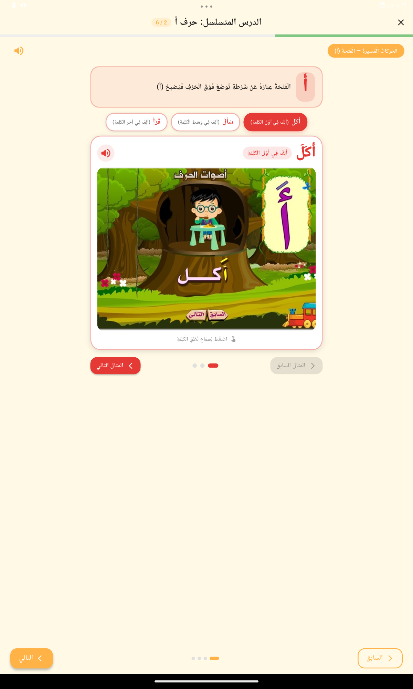
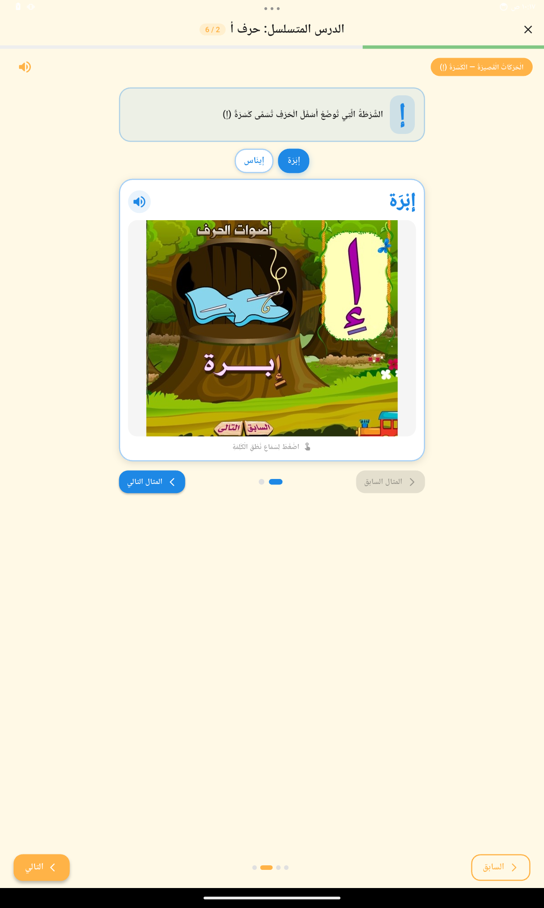
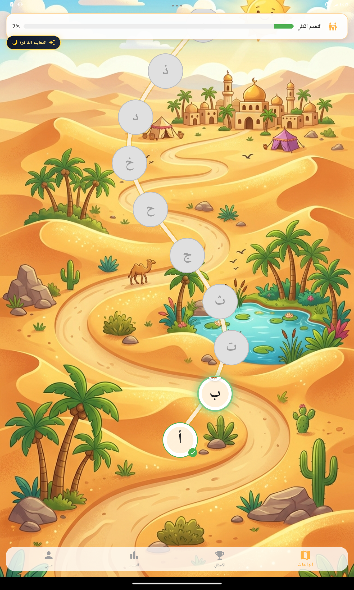
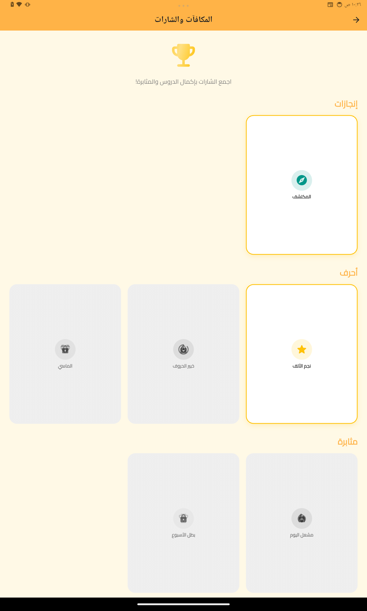
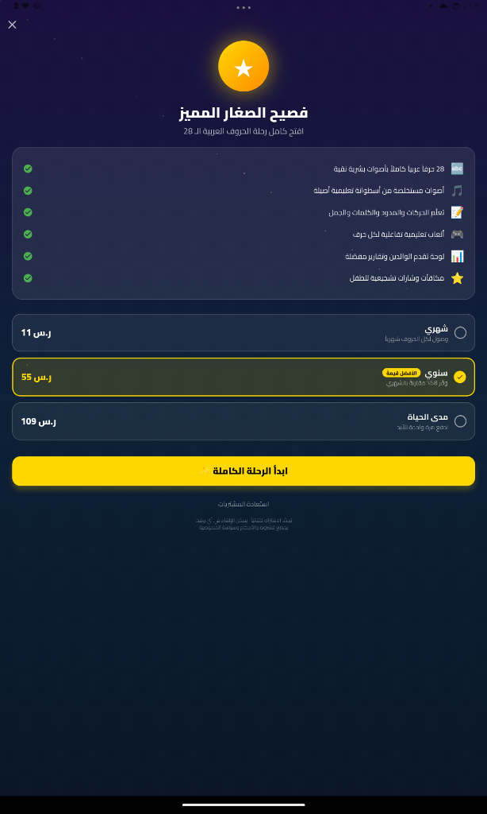

# فصيح كيدز — تعلم العربية للأطفال

تطبيق Flutter لتعليم اللغة العربية للأطفال في مرحلة ما قبل المدرسة والمراحل الأولى.

## المميزات
- دروس تفاعلية بالحروف العربية (الباء، التاء، ...)
- ألعاب تعليمية (صيد الكلمات، النحلة، السيرك، التلوين، المطابقة)
- محطة التتبع — تعليم كتابة الحروف
- قصص صوتية مصورة لكل حرف
- واجهة مبهجة ومناسبة للأطفال

## Stack
- Flutter (Dart)
- Firebase (Auth, Firestore, Storage)
- Riverpod state management
- Custom Arabic tracing canvas

## Status
🚧 قيد التطوير — Beta

## Screenshots
| | | |
|---|---|---|
|  |  |  |
|  |  | |
